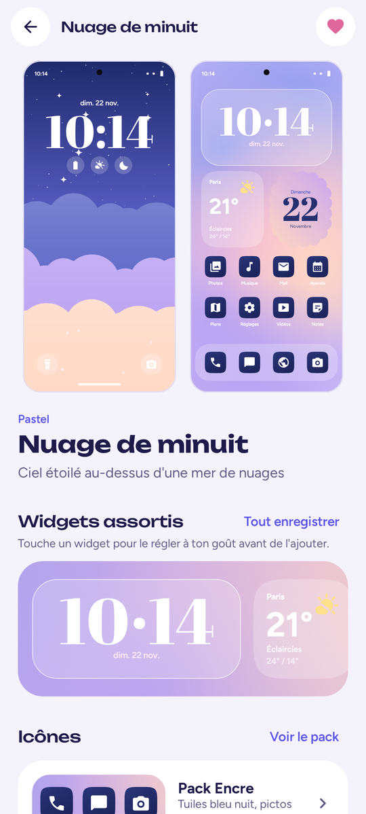
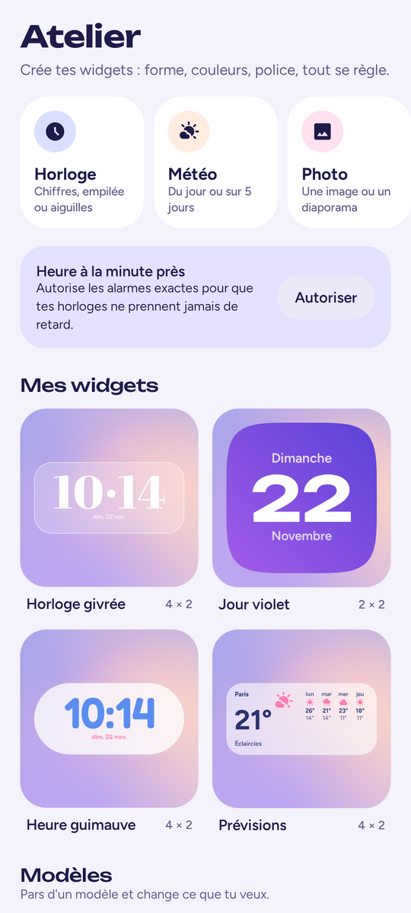
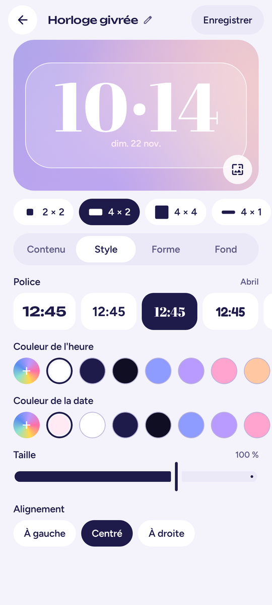
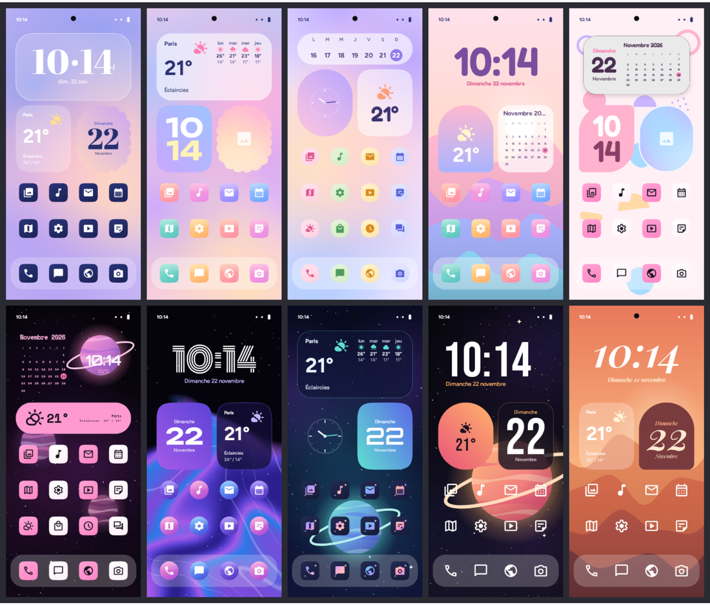
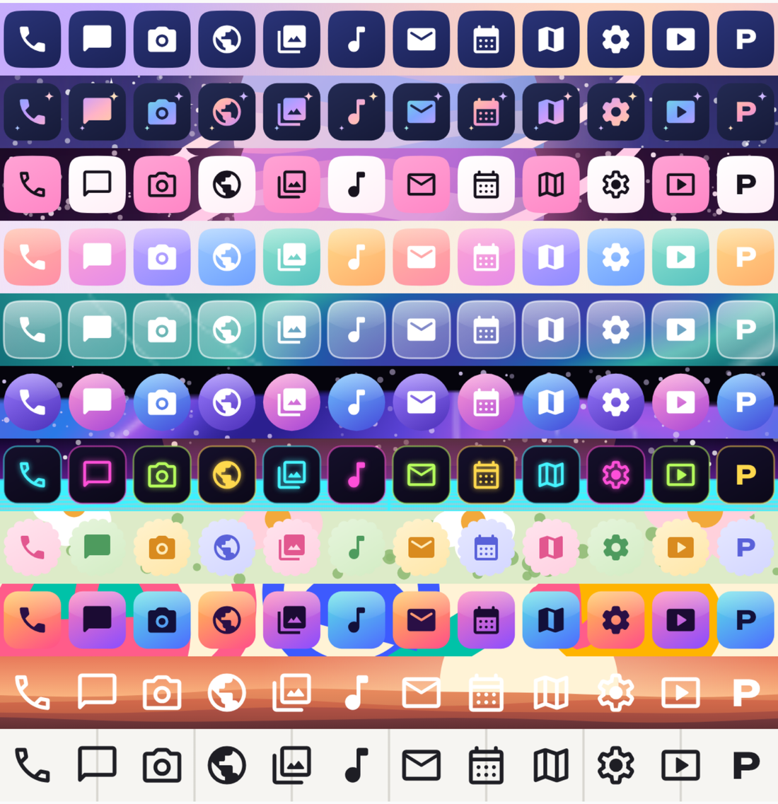

# Pimpr

Une application Android pour habiller son téléphone : thèmes complets, packs d'icônes
et widgets entièrement réglables, avec un aperçu fidèle de ce qui sera posé sur
l'écran d'accueil.

| Bibliothèque | Détail d'un thème | Atelier | Éditeur |
| --- | --- | --- | --- |
|  |  |  |  |

Les mêmes thèmes, vus côté écran d'accueil puis côté pack d'icônes :





## Ce que fait l'app

**Bibliothèque de thèmes.** 25 thèmes rangés en six catégories (Pastel, Cosmos, Nature,
Minimal, Néon et rétro, Kawaii). Chaque thème réunit un fond d'écran d'accueil, un fond
de verrouillage, un pack d'icônes et trois widgets assortis. Les fonds s'appliquent
depuis l'app, sur l'accueil, le verrouillage ou les deux.

**Packs d'icônes.** 11 styles (tuiles marine, dégradés étoilés, néon, verre, pétales…).
On choisit un pack, on coche ses applis, et Pimpr pose les icônes sur l'écran d'accueil :

- en **widget 1 × 1**, qui garde la forme exacte du pack ;
- ou en **raccourci** classique.

Les applis connues reçoivent un pictogramme dédié ; les autres gardent leur icône
d'origine, posée sur la tuile du pack.

**Atelier de widgets.** Cinq types : horloge, météo, photo, vidéo, calendrier. Pour chacun :

- **5 formats** : 2 × 2, 4 × 2, 4 × 4, 4 × 1, 2 × 4 (et redimensionnables ensuite) ;
- **6 formes** : coins arrondis réglables de l'angle droit à la pilule, squircle, pilule,
  arche, feuille, fleur ;
- **fond** uni, dégradé (couleurs et direction), image ou transparent, avec opacité ;
- **contour, ombre, marge intérieure** ;
- **12 polices**, couleurs libres (palette ou teinte/saturation/luminosité), taille du texte ;
- réglages propres à chaque type : horloge en chiffres, empilée ou à aiguilles, fuseau
  horaire ; météo compacte, détaillée ou avec prévisions ; photo avec zoom, cadrage,
  filtres, diaporama et légende ; vidéo en boucle animée ; calendrier du jour ou du mois ;
- ce qui se passe quand on touche le widget (ouvrir Pimpr, une appli, ou rien).

## Installer

Il faut Android 8.0 ou plus récent.

1. Récupère `app-debug.apk` : soit dans l'onglet **Actions** du dépôt GitHub (artefact
   `pimpr-debug-apk` du dernier build), soit en compilant (voir plus bas).
2. Ouvre le fichier sur le téléphone et autorise l'installation depuis cette source.

## Compiler

Prérequis : JDK 17 ou plus, et le SDK Android (plateforme 37.1). Android Studio installe
les deux.

```bash
./gradlew :app:assembleDebug
```

L'APK est écrit dans `app/build/outputs/apk/debug/`.

```bash
./gradlew :app:testDebugUnitTest
```

lance les tests unitaires.

```bash
./gradlew :app:updateDebugScreenshotTestDefaultTestSuite
```

rend tous les écrans et toutes les planches du catalogue en PNG, sans émulateur, dans
`app/src/screenshotTestDefaultDebug/` (dossier non versionné, car volumineux).

## Comment c'est construit

Kotlin et Jetpack Compose, un seul module `app`.

- `render/` : le moteur de dessin. `WallpaperPainter` (fonds d'écran), `IconRenderer`
  (icônes), `WidgetRenderer` (widgets) et `PreviewPainter` (écrans de téléphone complets)
  dessinent sur un `Canvas` Android. Rien n'est une image embarquée : une scène, une
  palette et une graine suffisent.
- `widget/` : les widgets d'écran d'accueil. Le même `WidgetRenderer` produit le bitmap
  envoyé au launcher, donc l'aperçu de l'éditeur est exactement ce qu'on obtient.
  `Schedules` programme les mises à jour (alarme à la minute pour l'heure, tâche
  périodique pour la météo), `Pinner` demande l'ajout au launcher.
- `data/` : designs enregistrés en JSON, météo Open-Meteo avec cache disque, import des
  photos et vidéos, catalogue des thèmes et des packs (`data/catalog/`).
- `ui/` : les écrans Compose. Chaque écran est une fonction sans état, branchée aux
  données dans `ui/PimprRoot.kt`.

## Limites à connaître

- **Vidéo.** Android ne lit pas de vidéo dans un widget. Pimpr extrait jusqu'à 24 images
  de la vidéo et les fait défiler en boucle, sans le son. Plus le widget est grand, plus
  la boucle est réduite en résolution pour respecter la limite mémoire du système.
- **Icônes.** Android ne laisse aucune appli changer les icônes des autres. Pimpr pose
  donc des raccourcis ou des widgets 1 × 1 à côté des icônes d'origine, et Android
  demande une confirmation pour chacun.
- **Heure.** Pour une horloge juste à la minute, il faut accorder l'autorisation
  « alarmes exactes » (l'app le propose). Sans elle, l'heure peut afficher un peu de retard.
- **Météo.** Une ville se choisit par recherche ; l'app n'utilise pas la localisation.
- **Langue.** L'interface est en français uniquement.
- **Signature.** Les builds sont signés avec la clé de test du dossier `keystore/`,
  publique par nature : elle sert à installer et mettre à jour des builds de test, pas à
  publier sur le Play Store.

## Crédits

Pictogrammes Material Symbols (Apache 2.0), polices sous licence SIL Open Font,
données météo Open-Meteo (CC BY 4.0). Détails dans [NOTICE.md](NOTICE.md).
