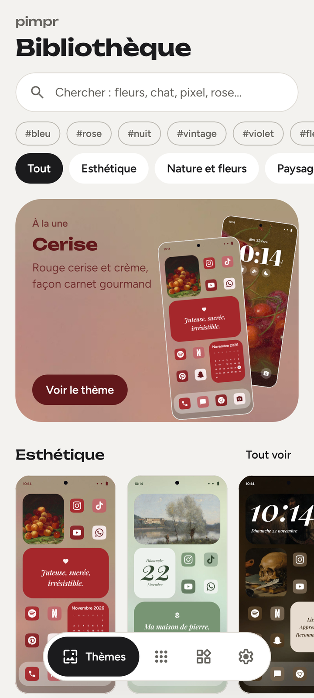
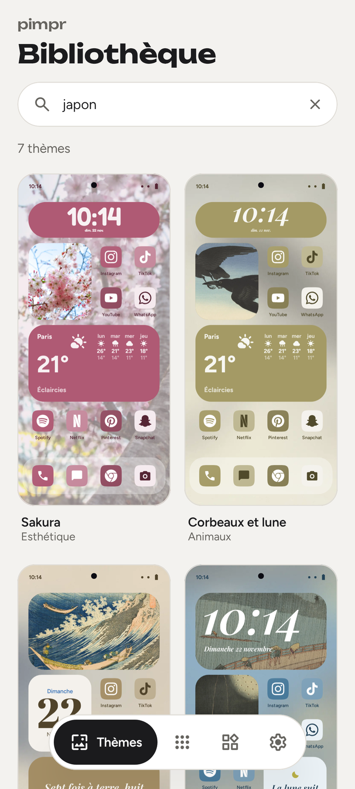
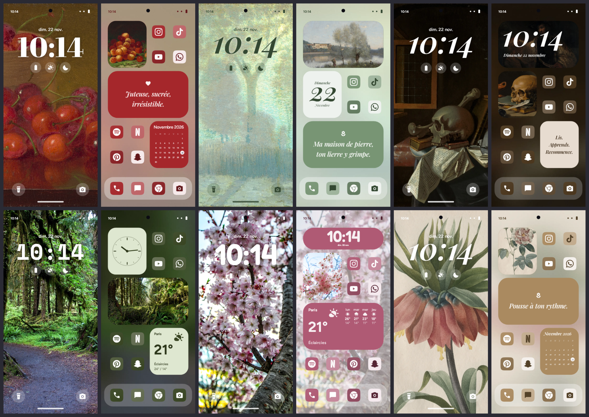
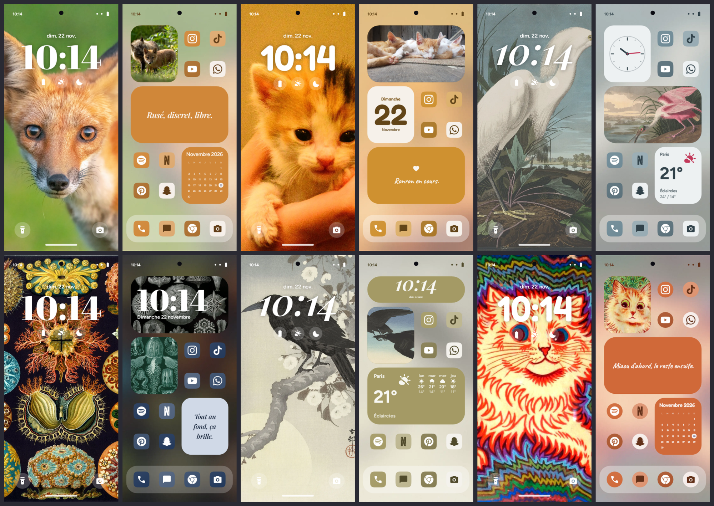
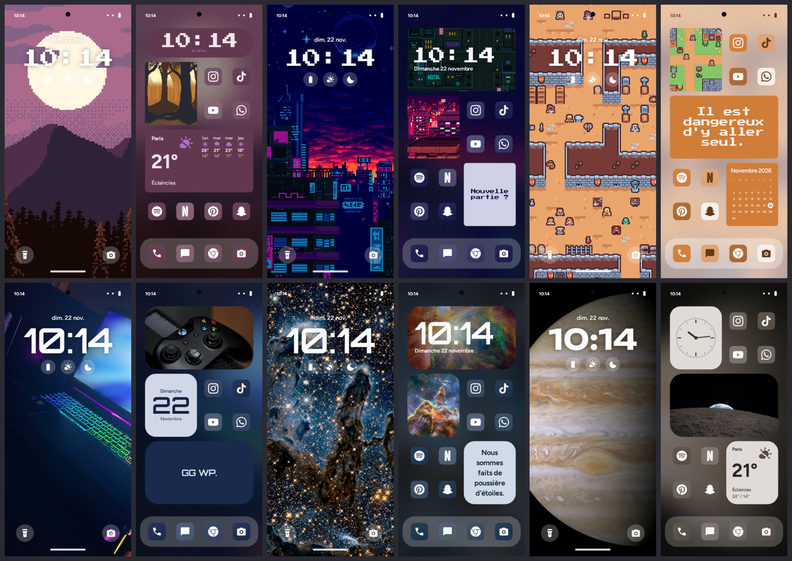

# Pimpr

Une application Android pour habiller son téléphone : thèmes complets, packs d'icônes
et widgets entièrement réglables, avec un aperçu fidèle de ce qui sera posé sur
l'écran d'accueil.

| Bibliothèque | Recherche | Détail d'un thème | Atelier |
| --- | --- | --- | --- |
|  |  |  |  |

Quelques thèmes, écran de verrouillage puis écran d'accueil :







## Ce que fait l'app

**Bibliothèque de thèmes.** 61 thèmes rangés en douze catégories : Esthétique, Nature et
fleurs, Paysages, Animaux, Mignon, Anime et Japon, Gaming, Cosmos, Art, Pastel, Minimal,
Néon et rétro. 36 d'entre eux reposent sur des images du domaine public (tableaux,
estampes, photos de la NASA et des parcs nationaux, pixel art) ; les 25 autres sont
dessinés par le code. Chaque thème réunit un fond de verrouillage, un fond d'accueil
assorti, un pack d'icônes et, pour les thèmes à images, vingt-six widgets déjà réglés.

**Recherche.** Un champ en haut de la bibliothèque cherche dans les noms, les catégories
et les mots-clés (« japon », « pixel nuit », « rose »…), sans tenir compte des accents.
Les mots-clés d'un thème se touchent pour relancer la recherche.

**Widgets de thème prêts à poser.** Dans la fiche d'un thème, chaque widget a un bouton
« Ajouter » : il est enregistré tel quel, avec les images et les couleurs du thème, et
proposé à l'écran d'accueil. Le bouton de réglage à côté l'ouvre dans l'éditeur si on
veut le changer.

**Installation guidée.** « Installer le thème » déroule trois étapes : le fond d'écran,
les trois widgets phares, puis les icônes. Android demande de confirmer chaque widget et
chaque icône, c'est lui qui les pose.

**Packs d'icônes.** Deux packs par thème à images, plus onze styles indépendants : un pack
aux tuiles unies, et une version « illustrée » dont chaque tuile est taillée dans une
image du thème. On choisit un pack, on coche ses applis, et Pimpr pose les icônes sur
l'écran d'accueil :

- en **widget 1 × 1**, qui garde la forme exacte du pack ;
- ou en **raccourci** classique.

Environ 150 applis courantes (Instagram, TikTok, WhatsApp, Spotify, Discord…) reçoivent
leur logo aux couleurs du pack ; les autres ont un pictogramme générique ou gardent leur
icône d'origine, posée sur la tuile du pack.

**Fonds d'écran.** Un onglet à part : tous les fonds des thèmes, filtrables par catégorie,
à poser sur l'accueil, le verrouillage ou les deux. « Un nouveau fond chaque jour » fait
tourner le catalogue, ou une seule catégorie, sans rien demander. Et un créateur de fond :
tes photos en polaroïds, en mosaïque, en pellicule, en cœur ou en plein écran, sur le
décor de ton choix (couleur libre ou image d'un thème), avec un mot en bas et un filtre.

**Atelier de widgets.** Douze types :

- **horloge** : chiffres, empilée, à volets ou à aiguilles, fuseau horaire au choix ;
- **météo** : compacte, détaillée ou avec prévisions ;
- **photo** : seule, en diaporama, ou en mur de photos (polaroïds, mosaïque, pellicule, cœur) ;
- **vidéo** : une courte boucle animée ;
- **calendrier** : le jour ou le mois ;
- **texte** : une citation à soi, ou une phrase différente chaque jour ;
- **compte à rebours** : jours restants avant une date, ou écoulés depuis ;
- **batterie** : anneau, jauge ou petite batterie à frimousse ;
- **pense-bête** : liste à cocher ou note libre ;
- **tableau de bord** : heure, batterie, stockage, avancée du jour et de l'année ;
- **musique** : précédent, lecture ou pause, suivant, pour le lecteur en cours ;
- **lune** : la phase de ce soir.

Les modèles tirés des thèmes se filtrent par type. Pour chaque widget :

- **5 formats** : 2 × 2, 4 × 2, 4 × 4, 4 × 1, 2 × 4 (et redimensionnables ensuite) ;
- **10 formes** : coins arrondis réglables de l'angle droit à la pilule, squircle, pilule,
  arche, feuille, fleur, cœur, nuage, hexagone, ticket ;
- **fond** uni, dégradé (couleurs et direction), image ou transparent, avec opacité ;
- **contour, ombre, marge intérieure** ;
- **20 polices**, couleurs libres (palette ou teinte/saturation/luminosité), taille du texte ;
- ce qui se passe quand on touche le widget (ouvrir Pimpr, une appli, ou rien).

L'aperçu de l'éditeur est posé sur un fond gris neutre, qu'on peut passer en clair ou en
sombre pour juger le contraste.

## Installer

Il faut Android 8.0 ou plus récent.

1. Récupère `app-debug.apk` : soit dans l'onglet **Actions** du dépôt GitHub (artefact
   `pimpr-debug-apk` du dernier build), soit en compilant (voir plus bas).
2. Ouvre le fichier sur le téléphone et autorise l'installation depuis cette source.

## Compiler

Prérequis : JDK 17 ou plus, et le SDK Android (plateforme 37.1). Android Studio installe
les deux.

```bash
./gradlew :app:assembleDebug
```

L'APK est écrit dans `app/build/outputs/apk/debug/`.

```bash
./gradlew :app:testDebugUnitTest
```

lance les tests unitaires.

```bash
./gradlew :app:updateDebugScreenshotTestDefaultTestSuite
```

rend tous les écrans et toutes les planches du catalogue en PNG, sans émulateur, dans
`app/src/screenshotTestDefaultDebug/` (dossier non versionné, car volumineux).

## Comment c'est construit

Kotlin et Jetpack Compose, un seul module `app`.

- `render/` : le moteur de dessin. `WallpaperPainter` (fonds d'écran), `IconRenderer`
  (icônes), `WidgetRenderer` (widgets) et `PreviewPainter` (écrans de téléphone complets)
  dessinent sur un `Canvas` Android. Un fond est soit une image embarquée (`res/raw`),
  soit une scène dessinée à partir d'une palette et d'une graine.
- `widget/` : les widgets d'écran d'accueil. Le même `WidgetRenderer` produit le bitmap
  envoyé au launcher, donc l'aperçu de l'éditeur est exactement ce qu'on obtient.
  `Schedules` programme les mises à jour (alarme à la minute pour l'heure, tâche
  périodique pour la météo), `Pinner` demande l'ajout au launcher.
- `data/` : designs enregistrés en JSON, météo Open-Meteo avec cache disque, import des
  photos et vidéos, catalogue des thèmes et des packs (`data/catalog/`).
- `tools/` : `build_themes.py` recadre les images sources, en tire les palettes et génère
  `ImageThemeData.kt` à partir de `themes_spec.py` (textes, mots-clés, couleurs imposées).
- `ui/` : les écrans Compose. Chaque écran est une fonction sans état, branchée aux
  données dans `ui/PimprRoot.kt`.

## Limites à connaître

- **Vidéo.** Android ne lit pas de vidéo dans un widget. Pimpr extrait jusqu'à 24 images
  de la vidéo et les fait défiler en boucle, sans le son. Plus le widget est grand, plus
  la boucle est réduite en résolution pour respecter la limite mémoire du système.
- **Icônes.** Android ne laisse aucune appli changer les icônes des autres. Pimpr pose
  donc des raccourcis ou des widgets 1 × 1 à côté des icônes d'origine, et Android
  demande une confirmation pour chacun.
- **Heure.** Pour une horloge juste à la minute, il faut accorder l'autorisation
  « alarmes exactes » (l'app le propose). Sans elle, l'heure peut afficher un peu de retard.
- **Musique.** Les trois boutons envoient les touches multimédia au lecteur en cours.
  Le widget n'affiche pas le titre joué : il faudrait l'accès aux notifications, que
  Pimpr ne demande pas.
- **Batterie.** Le niveau est relu toutes les cinq minutes environ, pas en continu.
- **Fond du jour.** Le changement est vérifié toutes les six heures : le nouveau fond
  arrive dans la matinée plutôt qu'à minuit pile.
- **Météo.** Une ville se choisit par recherche ; l'app n'utilise pas la localisation.
- **Poids.** Les images des thèmes portent l'APK à environ 38 Mo.
- **Langue.** L'interface est en français uniquement.
- **Signature.** Les builds sont signés avec la clé de test du dossier `keystore/`,
  publique par nature : elle sert à installer et mettre à jour des builds de test, pas à
  publier sur le Play Store.

## Crédits

Images des thèmes dans le domaine public ou sous CC0 (liste dans
[docs/CREDITS-IMAGES.md](docs/CREDITS-IMAGES.md)), pictogrammes Material Symbols
(Apache 2.0), logos Simple Icons (CC0, marques de leurs propriétaires), polices sous
licence SIL Open Font, données météo Open-Meteo (CC BY 4.0). Détails dans
[NOTICE.md](NOTICE.md).
